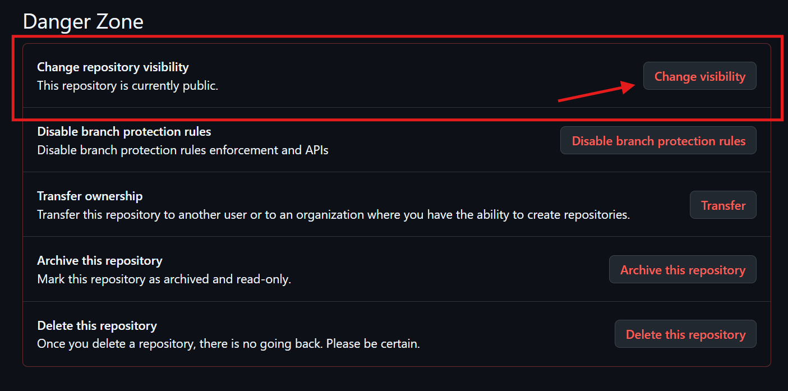
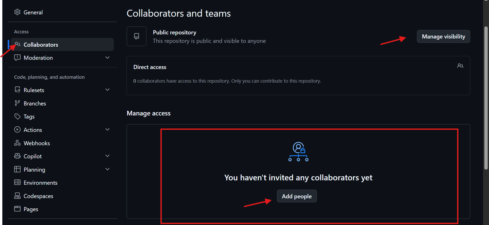
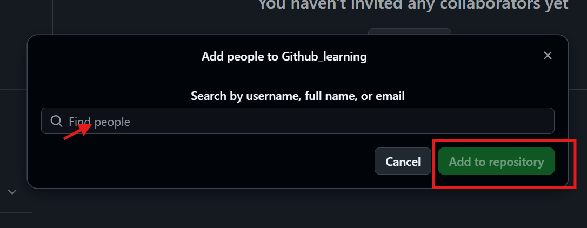
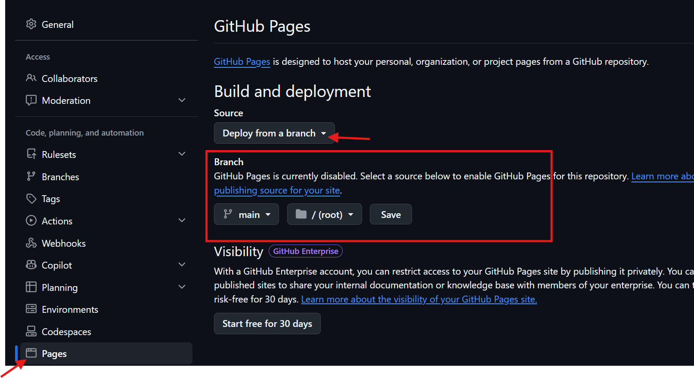

# GitHub Odds & Ends - Beginner Friendly Notes

## Overview

This guide covers:
1. Public vs Private Repositories
2. Collaborators
3. README Files
4. Markdown Basics
5. GitHub Gists
6. GitHub Pages

---

# 1. Public vs Private Repositories

## Public Repository
- Anyone can view the repository.
- Anyone can clone (download) the code.
- Others cannot directly modify your code.

### Example
A portfolio project that you want recruiters to see.

## Private Repository
- Only you and invited users can access it.
- Hidden from public searches.

### Example
A company or personal learning project.

---

# How to Change a Repository from Public to Private

## Step-by-Step

1. Open GitHub and sign in.
2. Open your repository.
3. Click **Settings**.
4. Scroll to the bottom to **Danger Zone**.
5. Find **Change repository visibility**.
6. Click **Change visibility**.
7. Select **Make Private**.
8. Type the repository name for confirmation.
9. Click **I understand, change repository visibility**.

### Sample image


### Example
Repository:

```text
student-management-system
```

You created it as public.

After changing visibility to private:

- Public users cannot view it.
- Only approved users can access it.

---

# 2. Collaborators

## What is a Collaborator?

A collaborator is a GitHub user who is allowed to contribute to your repository.

They can:
- Clone code
- Pull changes
- Push changes
- Create branches
- Work with the owner

---

# How to Add a Collaborator (Step-by-Step)

## Repository Owner Steps

### Step 1
Open GitHub repository.

### Step 2
Click **Settings**.

### Step 3
From the left menu select:

```text
Collaborators and teams
```

### Step 4
Click:

```text
Add people
```
#### sample image

### Step 5
Search using:
- GitHub username
- Email address

### Step 6
Select the user.


### Step 7
Click:

```text
Add collaborator
```

### Step 8
GitHub sends an invitation.

---

## Collaborator Steps

1. Open GitHub notifications or email.
2. Accept invitation.
3. Repository becomes accessible.
4. Clone repository locally.

```bash
git clone <repo-url>
```

5. Make changes.

```bash
git add .
git commit -m "Added feature"
git push
```

---

## Example

Manoj owns:

```text
inventory-system
```

Ravi is added as collaborator.

After accepting invitation Ravi can:

```bash
git clone
git add
git commit
git push
```

---

# 3. README.md

README is the documentation file of a repository.

Typical contents:
- Project purpose
- Installation steps
- Usage instructions
- Features
- Contributors

### Example

```text
Student Management System
```

Features:
- Add student
- Delete student
- Search student

---

# 4. Markdown Basics

## Heading

```markdown
# Heading 1
## Heading 2
```

## Bold

```markdown
**Important**
```

## Italic

```markdown
*Important*
```

## Lists

```markdown
- Item 1
- Item 2
```

## Inline Code

```markdown
`git status`
```

## Code Block

````markdown
```bash
git status
```
````

---

# 5. GitHub Gists

A Gist is used to share small pieces of code without creating a complete repository.

### Example

```python
print("Hello World")
```

Use Gists for:
- Small scripts
- Notes
- Configurations
- Interview answers

---

# 6. GitHub Pages

GitHub Pages allows you to host a static website for free.

Supported:
- HTML
- CSS
- JavaScript

Not Supported:
- Databases
- Backend servers
- Node.js runtime
- Python runtime

### Example

Repository:

```text
portfolio
```

Website:

```text
https://username.github.io/portfolio
```

### Sample image of Github page creation


---

# Quick Interview Questions

## Can anyone edit my public repository?
No. Public means visible, not editable.

## What is README.md?
Project documentation file.

## What is Markdown?
A simple formatting language used in README files.

## What is a Collaborator?
A user who has permission to contribute.

## What is GitHub Pages?
Free static website hosting from GitHub.

---

# Final Summary

1. Public Repo = Visible to everyone.
2. Private Repo = Visible only to authorized users.
3. Collaborators = People who can contribute.
4. README.md = Project documentation.
5. Markdown = Formatting language.
6. Gists = Quick code-sharing.
7. GitHub Pages = Free static website hosting.
